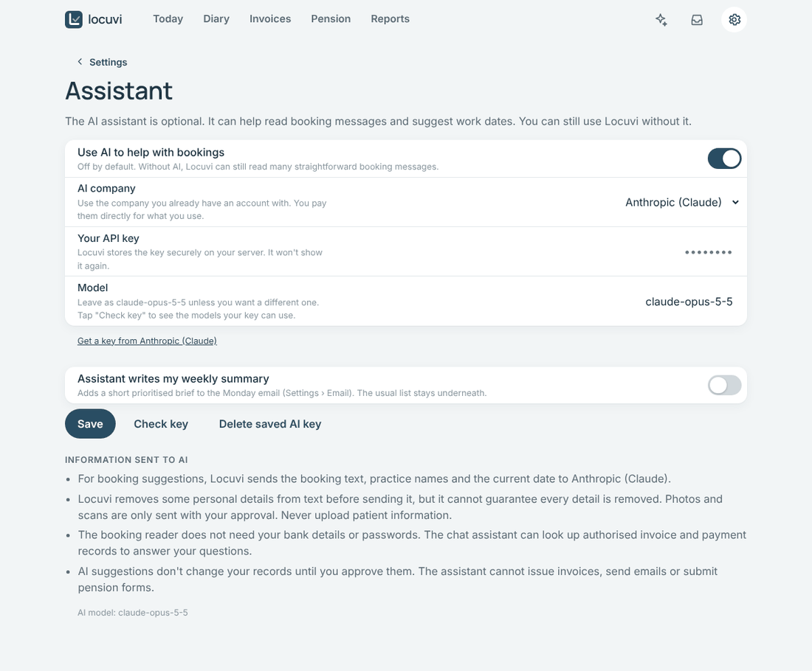

# Setting up the AI assistant

The AI assistant is **optional** and **off** until you turn it on. Locuvi works fully without
it, and reads most simple booking emails by itself.

With it on, the assistant can:

- 📨 read messy booking emails, scanned letters and photos, and suggest the sessions to add
- ✨ answer questions in **Ask Locuvi**, such as *"Which practices still owe me money?"*
- 📝 prepare invoice drafts and email drafts for you to check
- 📬 write a short summary at the top of your Monday email (if you choose)

It can **never** issue an invoice, send an email, record a payment or submit a pension form.
Every suggestion waits for you to approve it, and Locuvi checks every figure itself.
Calculations never use AI.

## Choose an AI company

You use your **own account** with an AI company and pay them directly for what you use. Light
use usually costs very little, and most companies let you set a monthly spending limit. Pick
whichever you prefer:

| Company | Good to know | Get a key |
| --- | --- | --- |
| **Anthropic (Claude)** | Locuvi's default. Reads emails, PDFs and photos | [console.anthropic.com](https://console.anthropic.com/settings/keys) |
| **OpenAI (ChatGPT)** | Reads emails and photos; PDFs are read from their text | [platform.openai.com](https://platform.openai.com/api-keys) |
| **Google Gemini** | Use a key with billing turned on: on the free tier Google may use what you send to improve its products | [aistudio.google.com](https://aistudio.google.com/apikey) |
| **DeepSeek** | Low cost; data is processed in China. Reads photos only with the model `deepseek-v4-flash-vision-exp`; otherwise paste the text | [platform.deepseek.com](https://platform.deepseek.com/api_keys) |
| **Mistral** | European company | [console.mistral.ai](https://console.mistral.ai/api-keys) |
| **xAI (Grok)** | | [console.x.ai](https://console.x.ai) |
| **OpenRouter** | One key for models from many companies | [openrouter.ai](https://openrouter.ai/keys) |

> [!NOTE]
> A ChatGPT Plus, Claude Pro or Gemini app subscription is **not** the same as an API key. API
> keys come from the developer pages linked above, and usually need a payment card or credit
> added first.

## Turn it on

1. Create a key on your chosen company's website (links above). Copy it. It's a long code,
   often starting with `sk-`.
2. In Locuvi, open **Settings › Assistant** and switch on **Use AI to help with bookings**.
3. Choose your **AI company**.
4. Paste the key into **Your API key** and tap **Save**.
5. Tap **Check key**. Locuvi asks the company which models your key can use. This is free.
   You should see *"Your key works"*.

**Model** is filled in for you. Leave it as it is unless you know you want another one; after
**Check key**, the box suggests the models your key can use.

> [!TIP]
> Changing to a different AI company forgets the saved key, so one company's key is never sent
> to another. Paste the new company's key and tap **Save**.

## What is sent to the AI company

- **For booking suggestions**: the booking text, your practice names and today's date.
  Before sending, Locuvi removes lines about patients, and email addresses, phone numbers,
  postcodes, and NHS and bank account numbers. It can't guarantee every detail is removed, so
  **never upload patient information**.
- **Photos and scans** can't be cleaned up first, so Locuvi asks you before sending each one.
- **Ask Locuvi** can look up your invoices, payments and diary to answer your question.
  Your bank details and passwords are never sent.
- Your key is stored **encrypted** on your server and is never shown again.

Each suggestion records which AI model made it.

## Turning it off

Switch off **Use AI to help with bookings**. To remove the key completely, tap
**Delete saved AI key**. You can also delete the key on the AI company's website at any time.

---

<b>For the person running the server</b>

- The key can also come from a file instead of the screen: mount it as a Docker secret and set
  `ANTHROPIC_API_KEY_FILE`. This is used only when the company is Anthropic.
- `LOCUVI_AI_MODEL` changes the default Anthropic model.
- The server needs outgoing HTTPS access to the chosen company's API.
- Tests and the e2e checks never call a real AI service (`e2e/fake_anthropic.py`, fake HTTP
  transports in `backend/tests/test_ai_providers.py`).

