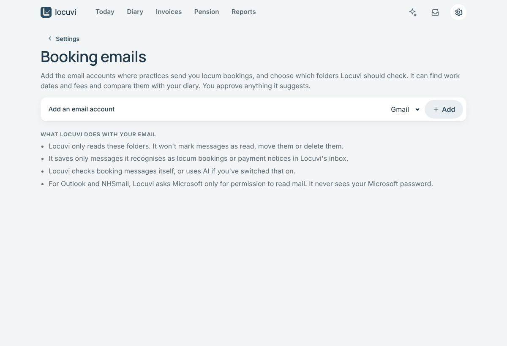
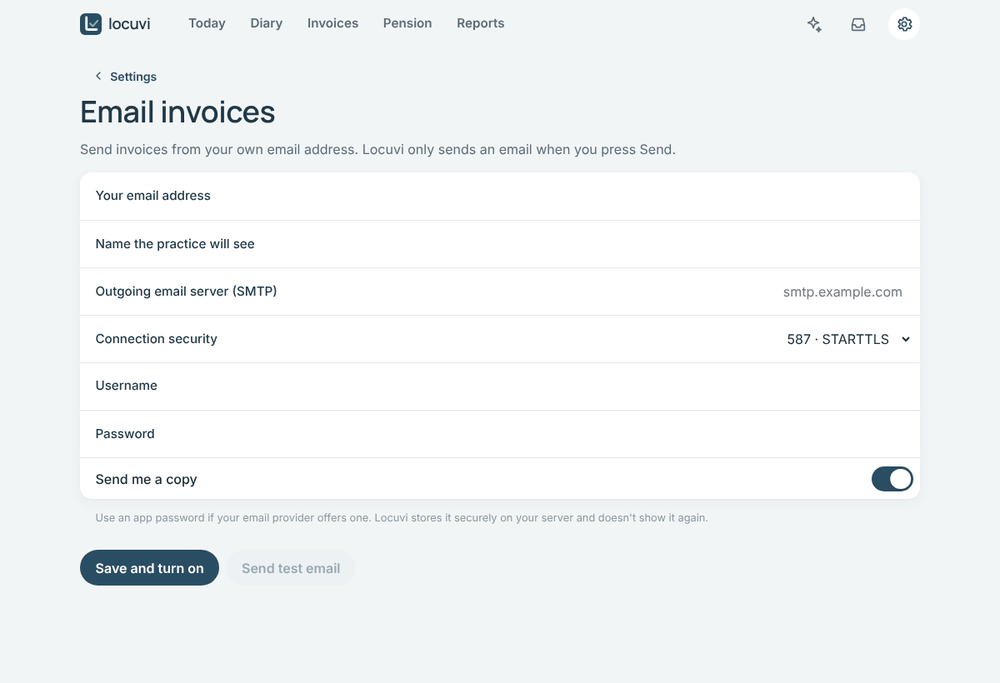

# Connecting your email

Locuvi can use your email in two separate, optional ways:

| | What it does | Where |
| --- | --- | --- |
| [**Part 1: Reading booking emails**](#part-1-reading-booking-emails) | Checks chosen folders for booking emails and payment notices, and shows you the sessions to add | **Settings › Booking emails** |
| [**Part 2: Sending invoices**](#part-2-sending-invoices-from-your-email-address) | Emails an invoice from your own address when you tap **Send** | **Settings › Email invoices** |

You can use either, both or neither. Without them, you can still paste booking emails in and
download invoice PDFs to send yourself.

## Part 1: Reading booking emails

> [!NOTE]
> Locuvi **only reads**. It never sends, moves, deletes or marks anything as read, and it only
> looks in the folders you choose. It keeps only the messages it recognises as bookings or
> payment notices.

### Which emails Locuvi keeps

Locuvi doesn't keep an email just because it mentions a "session" or a "clinic". It keeps a
message only when it is clearly about locum work. For example, it mentions **locum** or comes
from (or names) **one of your practices**, talks about booking or cover, and gives a **work
date** in the message itself. Dates in the email's header or in a quoted older reply don't
count. Newsletters, mailing lists and automatic replies are left out. Payment notices are kept
when they say *remittance* or *payment advice*, or give an amount paid for an invoice or by one
of your practices.

Everything else is skipped and never stored. After each check, Locuvi tells you how many
emails it skipped. Add each practice's email address under **Practices** so their messages are
recognised even when they don't say "locum".

If an earlier version of Locuvi kept emails that aren't bookings, the next check moves them to
**Settings › Recently deleted**. You can put any of them back within 30 days. Emails you've
already dealt with stay where they are.

Open **Settings › Booking emails** and tap **Add an email account**. You can add several, for
example your Gmail and your Outlook address. Locuvi checks them every hour, or tap
**Check for bookings now**.

> [!TIP]
> A folder (or Gmail label) called something like **Locum**, with a rule that files booking
> emails into it, works best. Locuvi then reads only those emails.

| Your email | How it connects | What you need |
| --- | --- | --- |
| **Gmail** | An "app password" | 5 minutes ([steps](#gmail)) |
| **Outlook, Hotmail, Live, Microsoft 365** | Sign in with Microsoft | 10 minutes, once ([steps](#outlook-hotmail-and-microsoft-365)) |
| **NHSmail** | Sign in with Microsoft | Approval from NHSmail ([read this](#nhsmail)) |
| **iCloud, Fastmail, others** | An "app password" | 5 minutes ([steps](#other-email-providers)) |

### Gmail

An **app password** is a separate password that lets one app read your email. It doesn't
reveal your real Google password, and you can cancel it at any time.

1. Make sure **2-Step Verification** is on for your Google account
   (<https://myaccount.google.com/security>).
2. Go to <https://myaccount.google.com/apppasswords>, create an app password called
   **Locuvi** and copy the 16 letters.
3. In Locuvi choose **Gmail**, type your Gmail address, paste the app password and tap
   **Connect and choose folders**. Your Gmail labels appear as folders: tick the ones with
   locum emails.

### Outlook, Hotmail and Microsoft 365

Microsoft doesn't let apps use your password, so Locuvi asks you to **sign in with Microsoft**
instead. For that, Microsoft needs to know about Locuvi. You tell it once, for free, in your
own Microsoft account. It looks technical but is mostly clicking through.

1. Go to <https://entra.microsoft.com> and sign in. (A personal Outlook/Hotmail account works;
   Microsoft may ask you to create a free "directory" first. Follow its prompts.)
2. Click **App registrations › New registration** and fill in:
   - **Name**: `Locuvi`
   - **Supported account types**: *Accounts in any organizational directory and personal
     Microsoft accounts*
   - **Redirect URI**: leave empty

   Click **Register**.
3. Copy the **Application (client) ID**: a long code like `1a2b3c4d-…`.
4. Click **Authentication**. Under **Advanced settings**, set **Allow public client flows** to
   **Yes**, then **Save**.
5. Click **API permissions › Add a permission › Microsoft Graph › Delegated permissions**.
   Tick `Mail.Read`, `User.Read` and `offline_access`, then **Add permissions**.
   (These mean: read mail, know your address, and stay signed in.)
6. In Locuvi choose **Outlook, Hotmail or Microsoft 365**, paste the ID and tap
   **Sign in with Microsoft**. Open the Microsoft page shown, type the code Locuvi gives you and
   approve. Then tick the folders to read.

Locuvi never sees your Microsoft password. It keeps only a sign-in pass, encrypted on your
server. **Sign out** in Locuvi deletes it. You can also remove Locuvi's access at
<https://myapps.microsoft.com> (work accounts) or <https://account.live.com/consent/Manage>
(personal accounts).

### NHSmail

NHSmail runs on Microsoft 365, but only allows apps that its administrators have approved.
Follow the [Outlook steps](#outlook-hotmail-and-microsoft-365) and choose **NHSmail**.

If Microsoft says **"Need admin approval"**, NHSmail hasn't approved the app. You can either:

- **Forward booking emails to Gmail**, and connect Gmail. Forward them one by one, or ask your
  organisation whether an automatic forwarding rule is allowed. NHSmail and local information
  governance rules may restrict forwarding outside NHSmail. Booking emails rarely contain
  patient details, but check before you forward.
- **Ask for approval** through your local NHSmail administrator, quoting the app ID and the
  read-only permissions above.

### Other email providers

Choose **Other (IMAP)** and enter:

- the **IMAP server**: for example `imap.mail.me.com` (iCloud) or `imap.fastmail.com` (Fastmail).
  Your provider's help pages list it under "IMAP settings".
- your **email address**
- an **app password** from your provider (iCloud: <https://account.apple.com> › Sign-In and
  Security › App-Specific Passwords).

## Part 2: Sending invoices from your email address

With this set up, **Send** on an invoice emails it to the practice with the PDF attached, from
your own address. Locuvi only sends when you tap **Send**, and every email sent is listed on
the invoice.

1. Open **Settings › Email invoices**.
2. Fill in:
   - **Your email address** and **Name the practice will see** (for example *Dr Alex Example*).
   - **Outgoing email server (SMTP)** and **Connection security**: see the table below.
   - **Username**: usually your full email address.
   - **Password**: an **app password** from your email provider, not your normal password.
3. Leave **Send me a copy** on if you want a copy of every invoice email.
4. Tap **Save and turn on**, then **Send test email**. You should receive it within a minute.

| Your email | Outgoing server | Connection security | Password to use |
| --- | --- | --- | --- |
| **Gmail** | `smtp.gmail.com` | 587 · STARTTLS | A Gmail app password ([create one](https://myaccount.google.com/apppasswords)) |
| **iCloud Mail** | `smtp.mail.me.com` | 587 · STARTTLS | An app-specific password ([account.apple.com](https://account.apple.com) › Sign-In and Security) |
| **Fastmail** | `smtp.fastmail.com` | 465 · SSL/TLS | A Fastmail app password (Settings › Privacy & Security) |
| **Other providers** | See your provider's "SMTP settings" help page | Usually 587 · STARTTLS | An app password if your provider offers one |

> [!WARNING]
> **Outlook, Hotmail, Microsoft 365 and NHSmail.** Microsoft is ending password-based sending
> from apps. For Microsoft 365 it is switched off by default from the end of December 2026,
> and many accounts already refuse it. Locuvi doesn't yet support Microsoft's newer sign-in
> for *sending*. Use a Gmail, iCloud or other address for sending, or tap **PDF** on the
> invoice and attach it to an email yourself.

**Weekly summary.** Once sending is on, **Email me a weekly summary** (on the same page)
sends you a short to-do list on Monday mornings, only when there's something to do.

---

**Something not working?** For reading, each account shows its last check and any problem in
**Settings › Booking emails**; the usual fix is a new app password, or signing in with
Microsoft again. For sending, Locuvi tells you if the server refused your username or
password. See also [Troubleshooting](TROUBLESHOOTING.md#email).
