<div align="center">


# Locuvi user manual

**Every session accounted for.**

Everything you can do in Locuvi, explained in plain English.
No technical knowledge needed.

</div>

> [!NOTE]
> All names, practices, bank details and figures in this manual are made up.
> "Dr Alex Example" and "Example Medical Practice" don't exist.

## Contents

1. [What Locuvi does](#1-what-locuvi-does)
2. [Signing in](#2-signing-in)
3. [Your first five minutes](#3-your-first-five-minutes)
4. [A normal month, step by step](#4-a-normal-month-step-by-step)
5. [Today: your home screen](#5-today-your-home-screen)
6. [Diary: recording your work](#6-diary-recording-your-work)
7. [Invoices](#7-invoices)
8. [Getting paid](#8-getting-paid)
9. [Corrections: cancelling and credit notes](#9-corrections-cancelling-and-credit-notes)
10. [NHS pension forms](#10-nhs-pension-forms)
11. [Reports and your tax return](#11-reports-and-your-tax-return)
12. [Inbox and booking emails](#12-inbox-and-booking-emails)
13. [The AI assistant (optional)](#13-the-ai-assistant-optional)
14. [Settings, one by one](#14-settings-one-by-one)
15. [Undo, deleting and Recently deleted](#15-undo-deleting-and-recently-deleted)
16. [Sharing Locuvi with your household](#16-sharing-locuvi-with-your-household)
17. [Using Locuvi on your phone](#17-using-locuvi-on-your-phone)
18. [Common questions](#18-common-questions)
19. [Words explained](#19-words-explained)

---

## 1. What Locuvi does

Locuvi looks after the admin side of GP locum work:

| You do this | Locuvi does this |
| --- | --- |
| Tap the days you worked | Remembers each practice's fee, and works out what you're owed |
| Tap **Create invoice** when a month ends | Fills in the invoice, adds the practice's NHS pension contribution, and creates a numbered PDF |
| Tap **Send** | Emails the invoice from your own email address |
| Tap **Record as paid**, or upload a bank statement | Keeps track of who has paid and who is late |
| Open **Pension** after the month ends | Prepares the figures for your NHS locum Form A and Form B |
| Open **Reports** at the end of the tax year | Gives your accountant the totals, spreadsheets and every PDF |

Three things Locuvi **never** does by itself:

- 📧 It never **sends an email**. You always tap Send.
- 🏛 It never **submits a pension form** or pays contributions. It prepares figures; you submit the official forms.
- 💷 It never **records a payment** you haven't confirmed.

## 2. Signing in

Open Locuvi in your web browser, using the address the person who set it up gave you. It
works on a computer, tablet or phone.

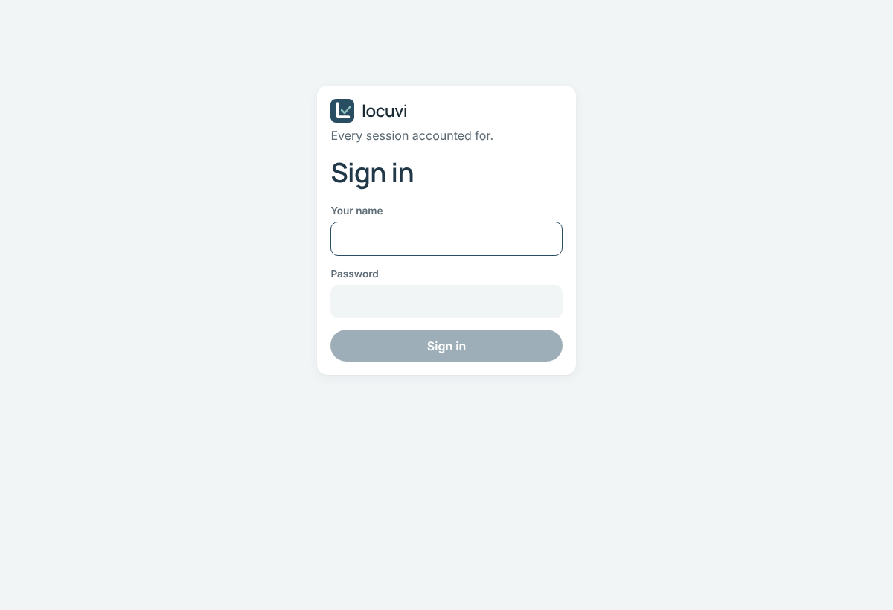

Type your **password** and tap **Sign in**. If more than one person in your household uses
Locuvi, you'll also see **Your name**: type the name your profile was created with.

- You stay signed in for 12 hours on that device.
- After 5 wrong passwords in a row, Locuvi makes you wait a few minutes. This protects you
  from someone guessing.
- Forgotten your password? See [Common questions](#18-common-questions).

## 3. Your first five minutes

The first time you sign in, Locuvi asks three short questions. You can tap
**I'll do this later** at any point and finish in **Settings**.

### Step 1: Your details

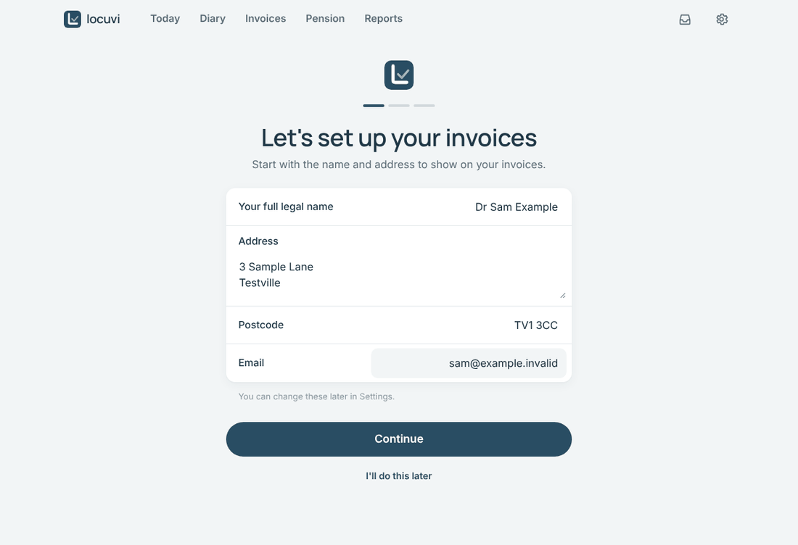

Your **full legal name**, **address**, **postcode** and **email**. These go at the top of
every invoice.

### Step 2: Where practices should pay you

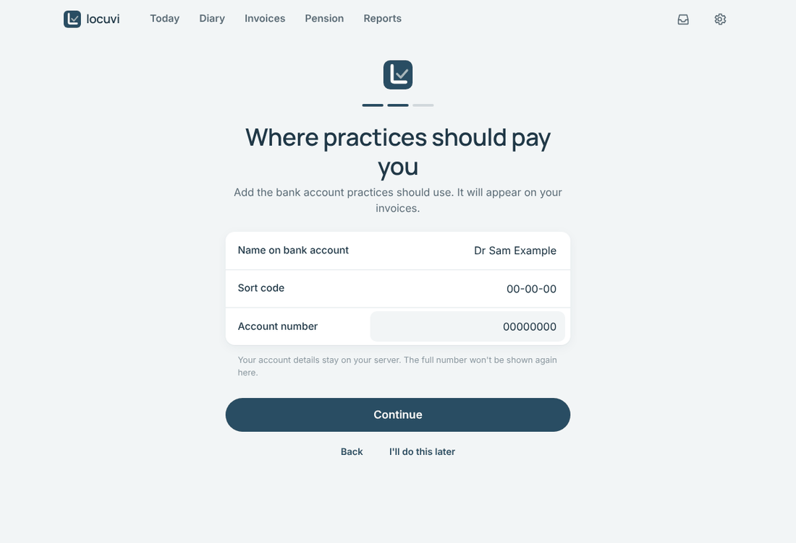

The **name on your bank account**, **sort code** and **account number**. They're printed on
your invoices so practices know where to pay. After you save, Locuvi only shows the last
four digits of the account number.

### Step 3: Your first practice

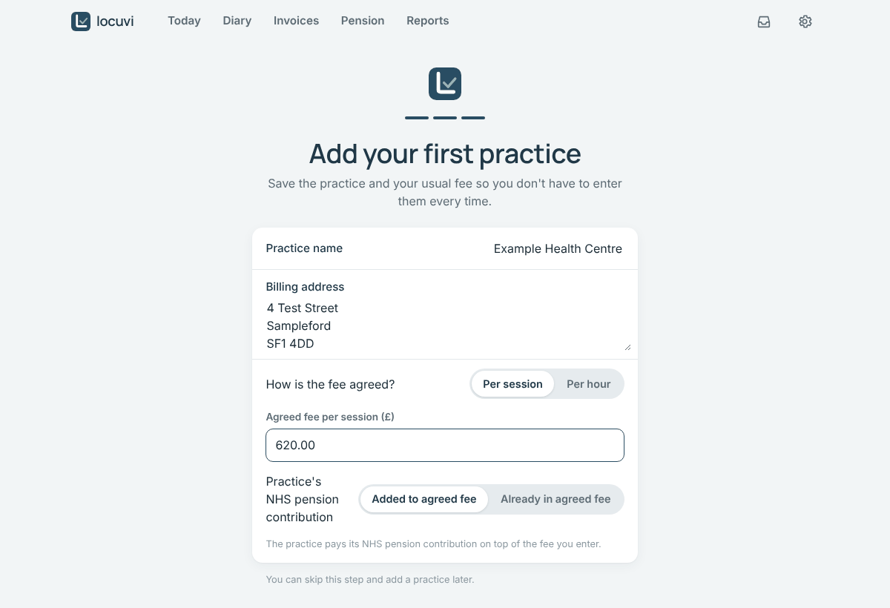

- **Practice name** and **billing address**: who the invoice is addressed to.
- **How is the fee agreed?** Choose **Per session** or **Per hour**.
- **Agreed fee**: your usual fee for this practice.
- **Practice's NHS pension contribution**:
  - **Added to agreed fee** (most common): the practice pays its pension contribution *on
    top of* the fee you agreed.
  - **Already in agreed fee**: the fee you agreed already includes the practice's pension
    contribution. Locuvi works out the basic fee and the pension part for you, so the
    practice isn't charged twice.

Tap **Get started**. That's it.

> [!TIP]
> Locuvi **saves as you type**: there's no Save button to forget on most screens. And most
> actions have an **Undo** button rather than an "Are you sure?" question.

## 4. A normal month, step by step

```
  1 Diary            2 Today              3 Invoice            4 Paid              5 Pension
  ───────            ───────              ─────────            ──────              ─────────
  Tap the days   →   "You can invoice  →  Check it,       →   Record the     →   Copy the figures
  you worked         for September"       tap Issue, Send      payment            onto Form A and B
```

**1. Tap the days you worked** in the **Diary**.

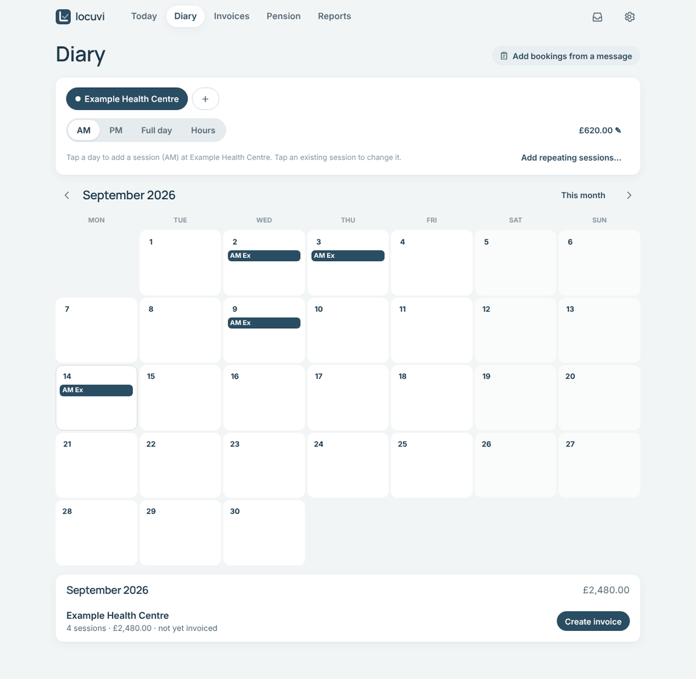

**2. When the month is over**, **Today** says *"You can invoice for September"*. Tap
**Create invoice**.

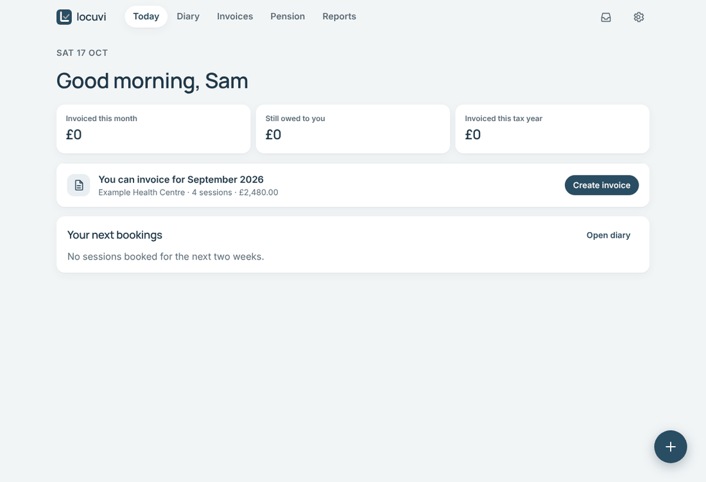

**3. Check the draft.** Everything is filled in for you. The box on the right,
**What the practice will pay**, adds it all up, including the practice's pension
contribution.

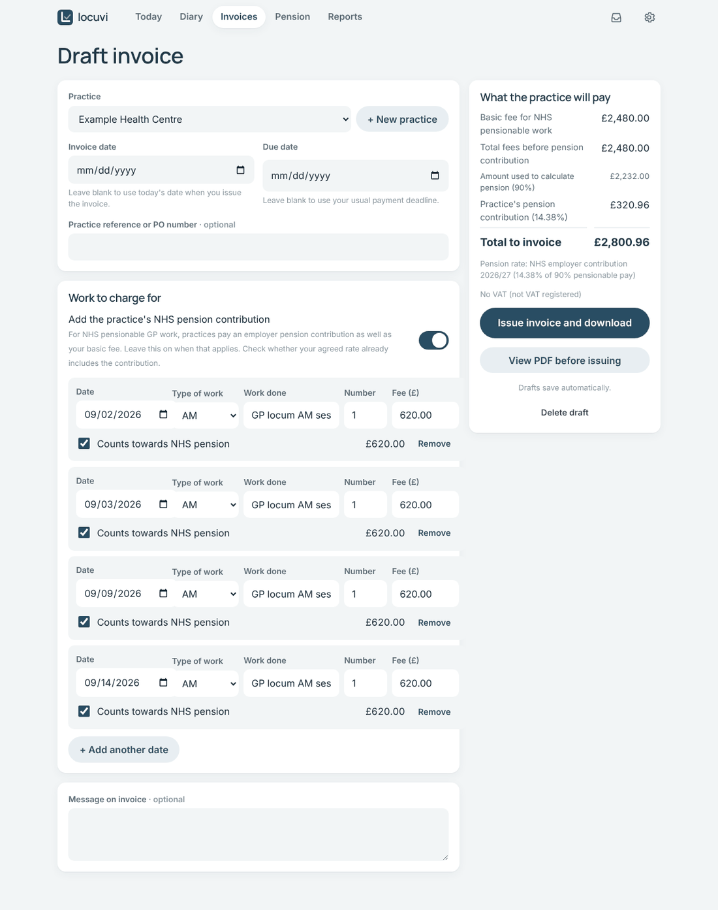

Tap **Issue invoice and download**. Locuvi shows a final check: the invoice number, what the
practice will pay, and how much of it goes towards your NHS pension.

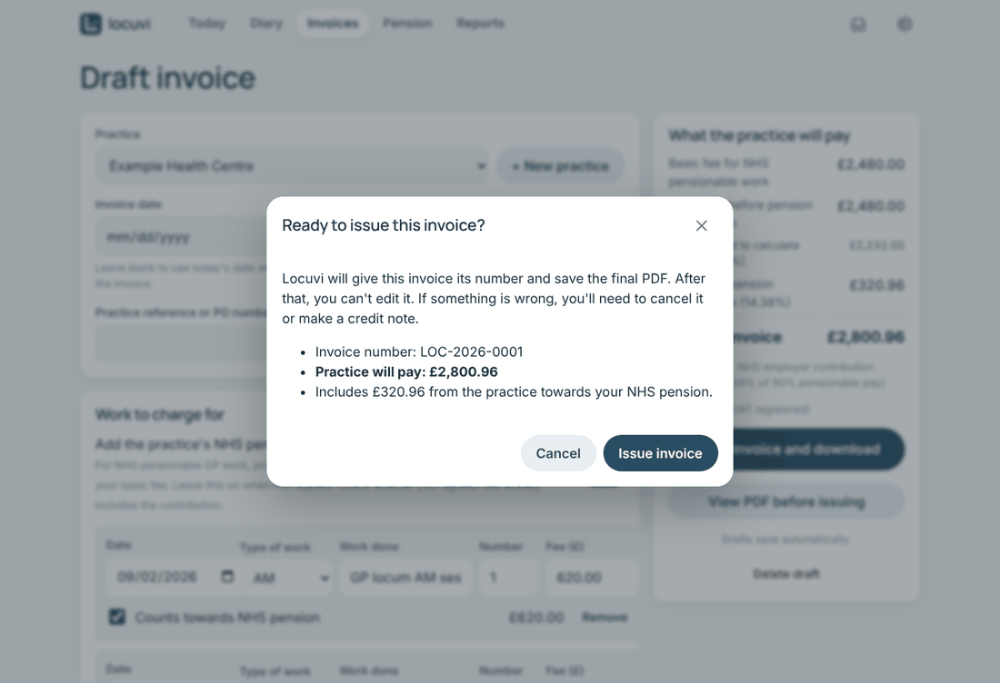

Tap **Issue invoice**. The invoice gets its number, its PDF is saved, and it downloads. Then
tap **Send** to email it to the practice.

**4. When the money arrives**, tap **Record as paid** on the invoice (or let Locuvi match
your bank statement, see [Getting paid](#8-getting-paid)).

**5. After the month ends**, open **Pension**. Locuvi shows the figures for your NHS forms.
Copy them onto the official forms, then tap **I've submitted Form B**.

## 5. Today: your home screen

**Today** shows what needs doing, with one button for each job.

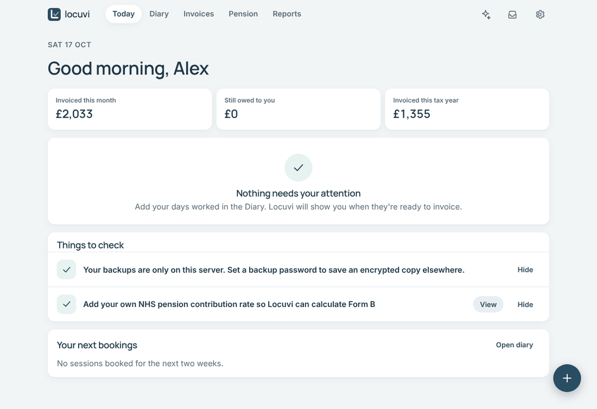

**The three boxes at the top** show what you've invoiced this month, what you're still owed,
and what you've invoiced this tax year.

**What needs doing** lists jobs as they come up: a month ready to invoice, a draft to check,
an invoice that's late, or a pension form that's due. If there's nothing to do, you'll see
*"Nothing needs your attention"*.

**Things to check** are reminders Locuvi works out by checking your records. For example:

| Area | Examples of reminders |
| --- | --- |
| Invoicing | Work that hasn't been invoiced · a draft you haven't checked for a while · a practice that needs a PO number · a practice with no billing address |
| Payments | An invoice that's late or due soon · bank payments to check · a refund you owe a practice |
| Your diary | A session that may have been entered twice · two bookings that overlap · booking suggestions waiting for you |
| NHS pension | Form B due (or late) · a Form A still waiting for the practice's signature · work approaching its 10-week pension deadline · your PCSE record not matching |
| Safety | No backup yet, or the last one is old · the backup check failed · a Nextcloud copy failed · an email account couldn't be checked |

Each reminder has a **View** button. Tap **Hide** to be reminded next week instead.

**Your next bookings** shows your work for the next two weeks. The round **+** button (bottom
right) adds a work session from anywhere.

## 6. Diary: recording your work

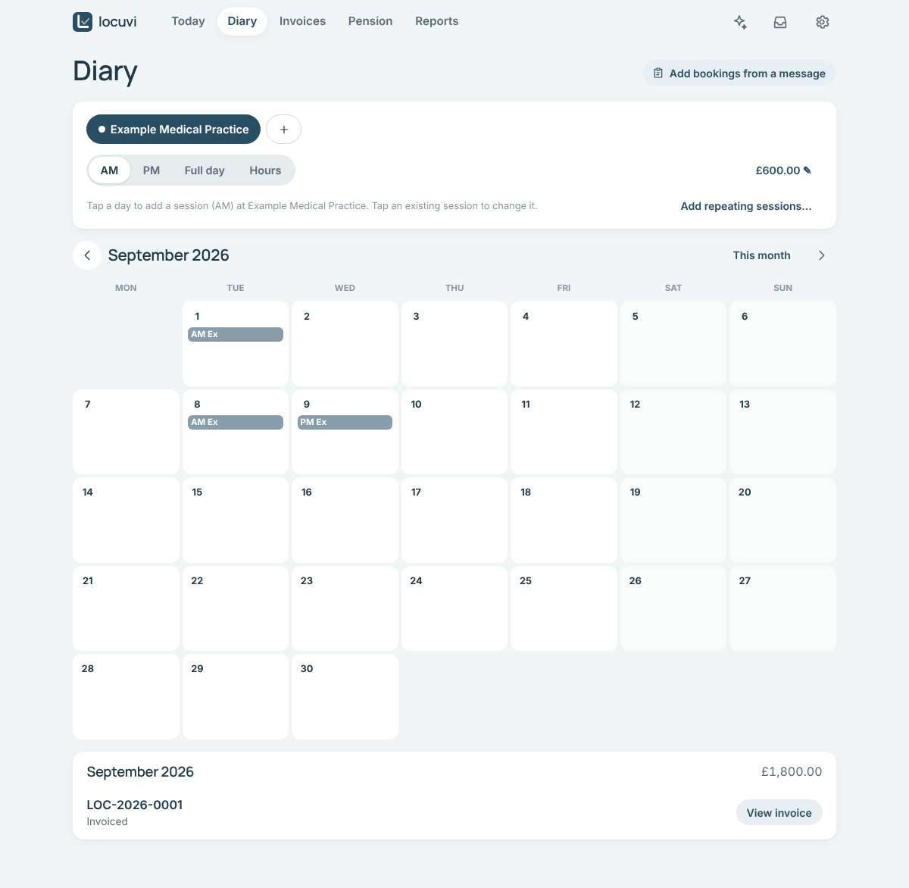

### Adding sessions

1. Choose the **practice** at the top. Tap **+** to add a new one.
2. Choose the **type of work**: **AM**, **PM**, **Full day** or **Hours**.
3. **Tap each day** you work. A label appears on the day, for example *AM Ex*.

The fee is shown on the right (for example **£640.00 ✎**). Locuvi remembers it for each
practice and type of work. Tap it to change it.

- **Hours**: choose **Hours**, enter the number of hours next to the fee, then tap the days.
  Locuvi uses the practice's hourly fee.
- **Picked the wrong day?** Tap the session and choose **Move forward one day**, or delete it.
- **Already invoiced?** Sessions on an issued invoice are locked, so your invoice and your
  diary always agree. Tap the session to open its invoice.

### Regular work

Tap **Add repeating sessions…**. Choose the **days** (for example Tuesday), **Every week** or
**Every other week**, and the **From** and **Until** dates. Locuvi uses your usual fee and
skips any date you're already booked.

### The monthly summary

Under the calendar, each practice's total for the month is shown, with whether it's been
invoiced and a button to **Create invoice** or **View invoice**.

### Adding work from a booking email

Copy the text of a booking email, tap **Add bookings from a message**, paste it in and tap
**Find work dates**. Locuvi lists the sessions it found, so you can check them before
anything is added.

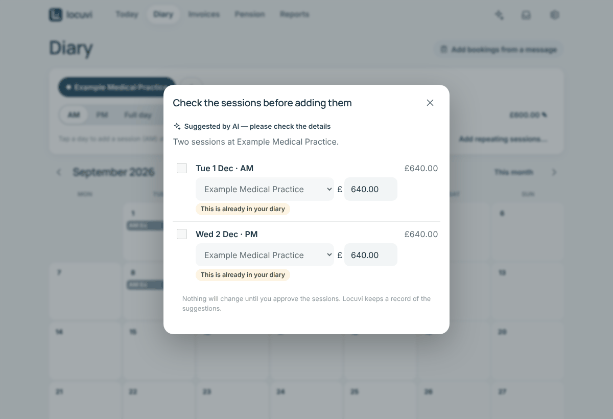

Locuvi points out anything that needs your attention:

| Label | Meaning |
| --- | --- |
| **This is already in your diary** | Nothing new to add |
| **You also have work booked at …** | A clash with another practice |
| **Cancel this session** | The message cancels work you'd booked |
| **Choose the practice** / **Add the fee** | Locuvi couldn't tell which practice, or the fee |
| **Saved fee: … The email appears to say something different** | Check which fee is right |
| **Already invoiced** | That work is on an issued invoice |

Tick the sessions you want and tap **Add sessions**. Nothing changes until you do, and you
can undo it afterwards.

## 7. Invoices

### Creating an invoice

The easiest way is **Create invoice** on **Today** or under the Diary calendar. Locuvi fills
in the practice, dates, fees and pension contribution.

You can also start from **Invoices › New invoice** and add dates by hand.

On the draft you can change:

| Field | Notes |
| --- | --- |
| **Invoice date** | Leave blank to use the date you issue it |
| **Due date** | Leave blank to use your usual payment deadline |
| **Practice reference or PO number** | Some practices need a purchase order (PO) number. Locuvi reminds you if they do |
| **Work to charge for** | One line per date: type of work, description, number and fee |
| **Counts towards NHS pension** | Untick for work that isn't NHS pensionable (for example private work) |
| **Message on invoice** | Optional, for example a thank-you |

**What the practice will pay** on the right shows the basic fee, the amount used for
pension (90%), the practice's contribution (14.38%) and the **Total to invoice**.

- **View PDF before issuing** shows exactly what the practice will receive.
- **Drafts save automatically.**
- **Delete draft** removes it. No invoice number is used up.

### Before you issue: the checks

Locuvi won't let you issue an invoice that's likely to be rejected or wrong. It asks you to
fix, for example:

- a missing practice billing address, or your own name, address or bank details
- a practice that needs a PO number
- NHS pensionable work across two calendar months. NHS pension forms are monthly, so tap
  **Make a separate invoice for each month** and Locuvi splits it for you.
- a pension rate that changes part-way through the dates

### Issuing

Tap **Issue invoice and download**, check the summary, then **Issue invoice**.

> [!IMPORTANT]
> **An issued invoice can't be changed.** Its number, contents and PDF are fixed for good.
> This is what accountants and HMRC expect, and it means your records can always be trusted.
> If something's wrong, see [Corrections](#9-corrections-cancelling-and-credit-notes).

Numbers are never reused, even if an invoice is later cancelled.

Here's what an issued invoice looks like. You can add your own logo and colour in
**Settings › Invoice appearance**.

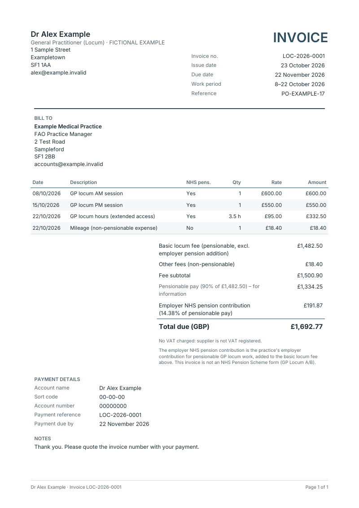

### Sending

Tap **Send** on the invoice. Locuvi prepares the email with the PDF attached; you can change
the **To**, **Subject** and **Message**, then tap **Send**. Set up your email once in
**Settings › Email invoices** ([how](EMAIL_SETUP.md#part-2-sending-invoices-from-your-email-address)).

Prefer your own email program? Tap **PDF** to download the invoice and attach it yourself.

### Your invoices

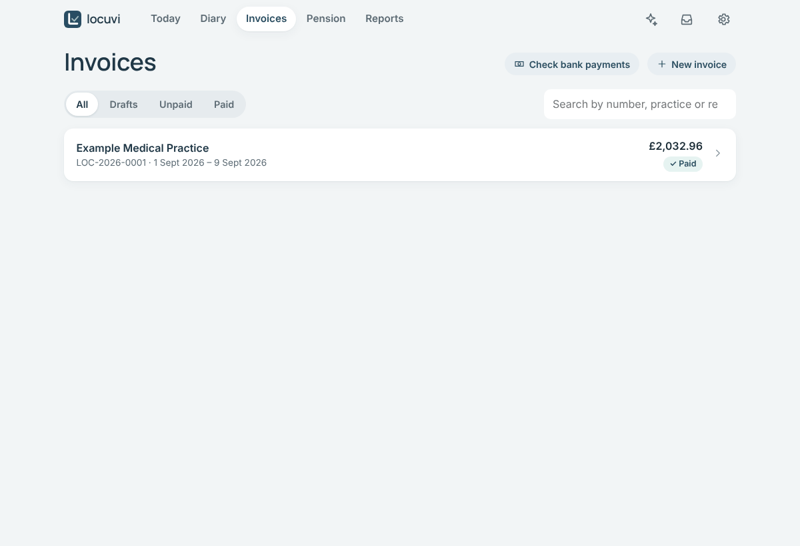

**Invoices** lists everything. Filter by **Drafts**, **Unpaid** or **Paid**, or search by
number, practice or reference. Open an invoice to see everything about it:

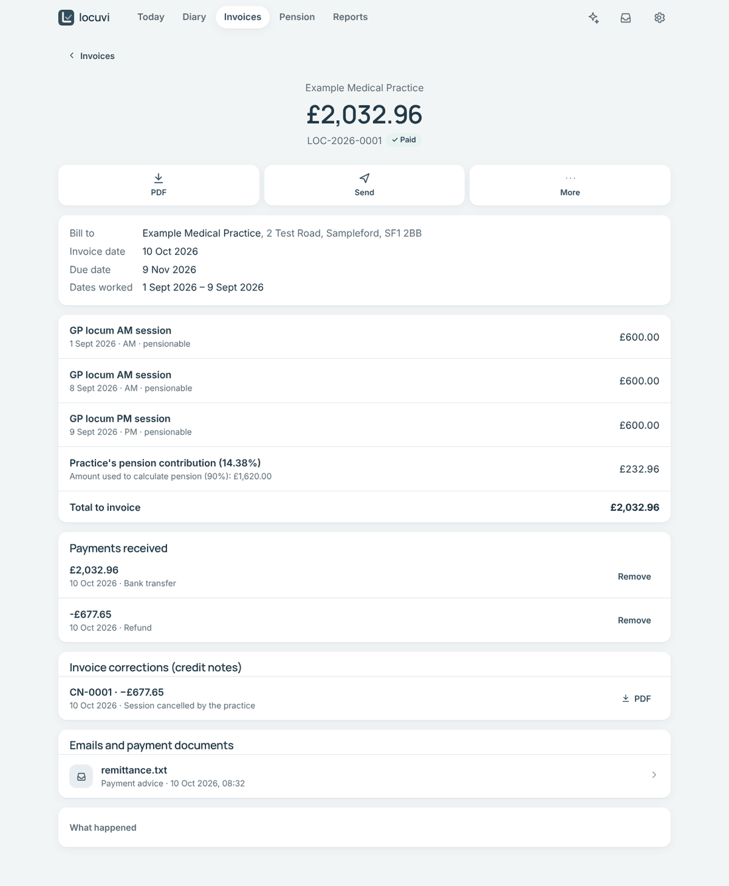

- **PDF** downloads it again at any time.
- **Send** emails it (see above).
- **Record as paid** appears while it's unpaid.
- **More** has the rest:

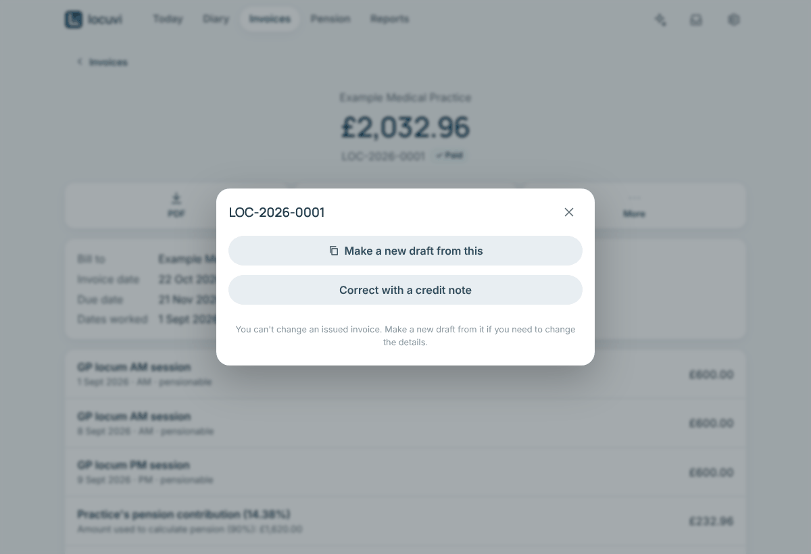

Underneath you'll see **Payments received**, **credit notes**, **Emails and payment
documents** linked to it, and **What happened** (a history of the invoice).

## 8. Getting paid

### Recording a payment by hand

Open the invoice and tap **Record as paid**. That records the full amount, today, by bank
transfer. Made a mistake? Tap **Undo**.

Paid only part, or by cheque? Use **More › Record a payment** and enter the **amount**,
**date money arrived** and **method**. The invoice shows as **Partly paid** until it's
settled.

### Matching a bank statement

Go to **Invoices › Check bank payments** and tap **Upload a bank statement**. Use the CSV
file your online banking lets you download (often under "Export" or "Download
transactions").

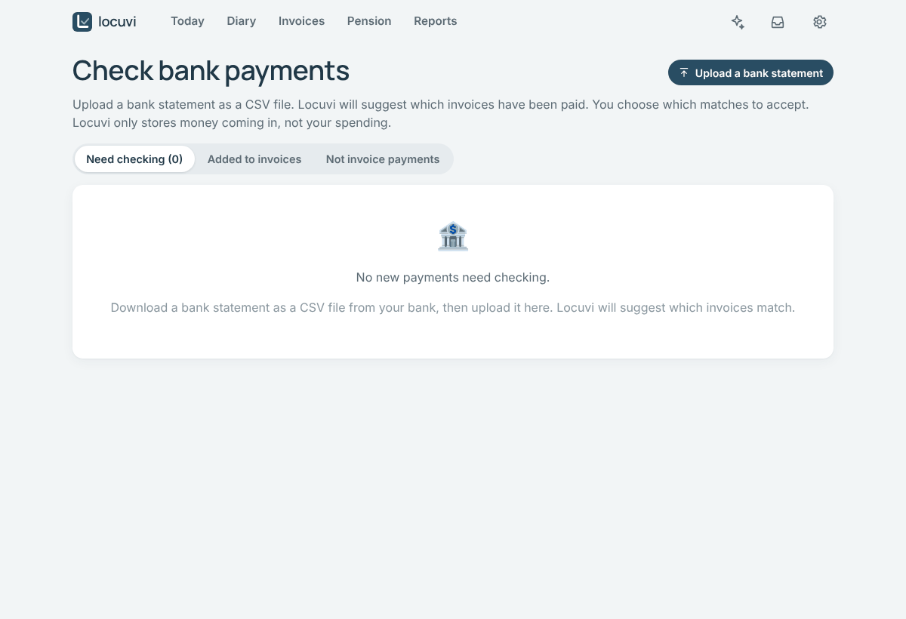

Locuvi:

- keeps **only money coming in**. Your spending is ignored and never saved.
- suggests which invoice each payment is for, and says why: *invoice number found in payment
  reference*, *amount and practice name match*, *amount matches*, or *one payment covers
  several invoices*.
- records nothing until you tap **Record suggested payments** (or **Confirm** on one).

A payment that isn't for an invoice? Tap **Not payment for an invoice**. Use the filters to
see **Need checking**, **Added to invoices** and **Not invoice payments**.

### Late payments

Locuvi tells you on **Today** when a payment is due soon and when it's late, with the number
of days. Late invoices appear first.

## 9. Corrections: cancelling and credit notes

Because issued invoices can't be edited, there are two ways to correct one:

| Situation | What to do |
| --- | --- |
| The practice **hasn't recorded or paid** the invoice yet | **More › Cancel invoice**, give a reason, then **Make a new draft from this**, correct it and issue the new one |
| The practice **has already recorded or paid** it | **More › Correct with a credit note** |

**Cancelling** keeps the invoice, its number and its PDF on record, marked as cancelled. You
can't cancel an invoice that has payments or credit notes; remove the payments first.

**A credit note** is an official correction that reduces an invoice without changing it.
Tick the lines to take off and say why (for example *Session on 3 Oct cancelled by the
practice*). It gets its own number (`CN-0001`, `CN-0002`…) and its own PDF. What's owed,
your pension figures and your reports all update.

**Refunds.** If the invoice was already paid, a credit note means the practice has overpaid.
The invoice shows **Refund needed** and **Today** reminds you. When you've paid them back,
tap **Record a refund**.

## 10. NHS pension forms

The **Pension** page prepares the figures for your monthly GP locum NHS pension forms.

> [!IMPORTANT]
> Locuvi **does not submit** forms or pay contributions. It gives you the figures. You fill in
> the official forms and send them. Always check the amounts and deadlines yourself.

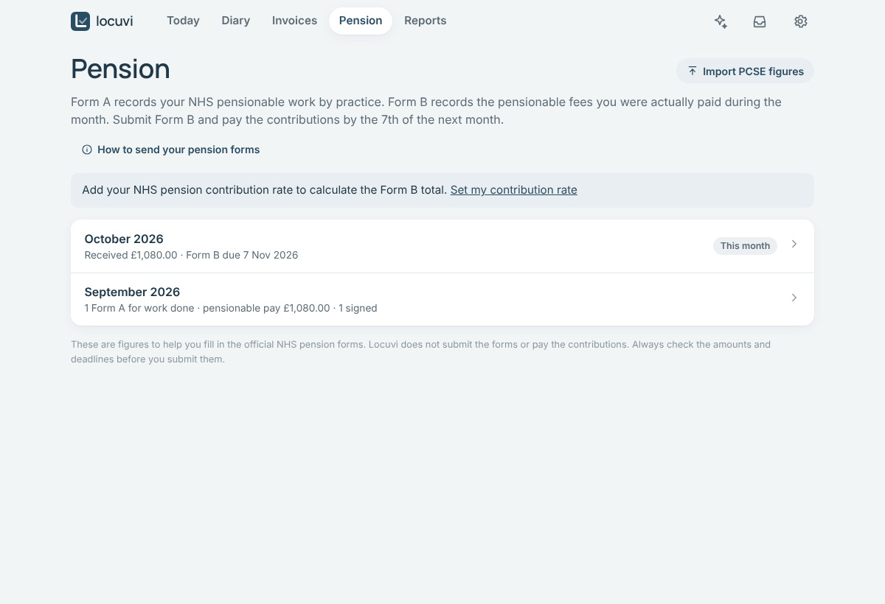

Each month in the list shows its forms and deadlines. Open a month to see the details:

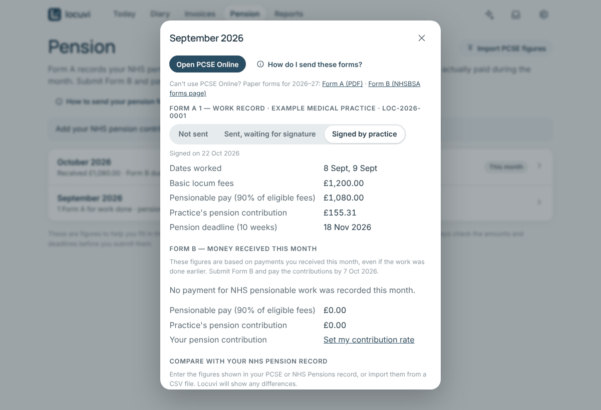

### Form A: the work you did

There's one **Form A** per practice for each month you worked. It shows the **dates
worked**, **basic locum fees**, **pensionable pay (90% of eligible fees)**, the **practice's
pension contribution** and the **10-week pension deadline**.

The practice has to sign Form A. Track it with the three buttons: **Not sent** →
**Sent, waiting for signature** → **Signed by practice**. Locuvi reminds you if a signature
is taking a while.

### Form B: the money you received

**Form B** is based on the fees you were **paid** that month, even if you did the work
earlier. It shows your pensionable pay, the practices' contributions and **your own
contribution**. Add your contribution rate once in **Settings › NHS pension** (tap
**Set my contribution rate**). Submit Form B and pay the contributions **by the 7th of the
following month**.

### When you're done

- **Download figures** gives you a worksheet PDF to work from.
- **I've submitted Form B** records that you've sent it. If the figures change afterwards
  (for example a late payment), Locuvi tells you: *Figures changed since you submitted*.

### Checking against your NHS pension record

Later, type in the figures shown in your PCSE or NHS Pensions record, or tap
**Import PCSE figures** to upload them as a CSV file. Locuvi says *Matches PCSE* or shows the
difference so you can follow it up.

> [!TIP]
> **How the numbers work.** For a £600 NHS session: 90% counts as pensionable pay (£540).
> The practice adds 14.38% of that (£77.65). The invoice total is £677.65. When the rates
> change, add the new one in **Settings › NHS pension**. Locuvi uses the right rate for each
> date. Pennies are rounded on each line.

## 11. Reports and your tax return

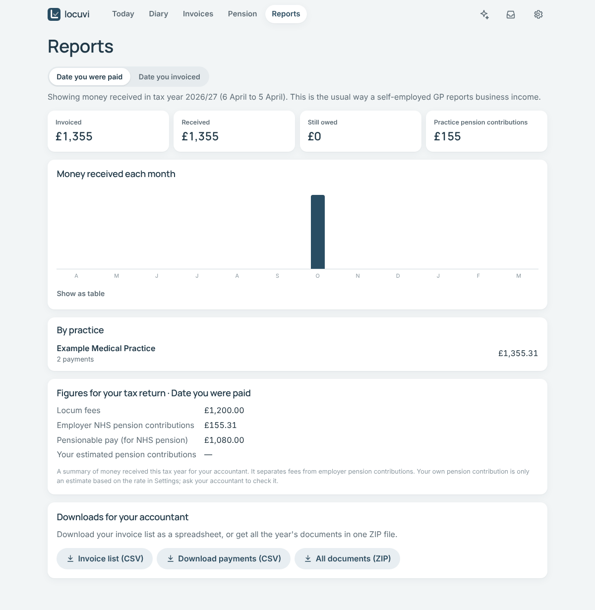

**Reports** shows one UK tax year (6 April to 5 April):

- **Show income by**: **Date you were paid** (how most self-employed GPs report income) or
  **Date you invoiced**. Ask your accountant which they use.
- **The totals**: invoiced, received, still owed and practice pension contributions.
- **Each month** as a chart. Tap **Show as table** for the numbers.
- **By practice**: who paid you what.
- **Figures for your tax return**: your locum fees kept separate from the practices' pension
  contributions, plus pensionable pay and an estimate of your own contributions.
- **Downloads for your accountant**: **Invoice list (CSV)**, **Download payments (CSV)** and
  **All documents (ZIP)**, which contains every invoice and credit note PDF for the year.
  CSV files open in Excel, Numbers or Google Sheets.

## 12. Inbox and booking emails

### The Inbox

The tray icon at the top right opens your **Inbox**: one place for booking emails, payment
advice, bank statements and pension letters.

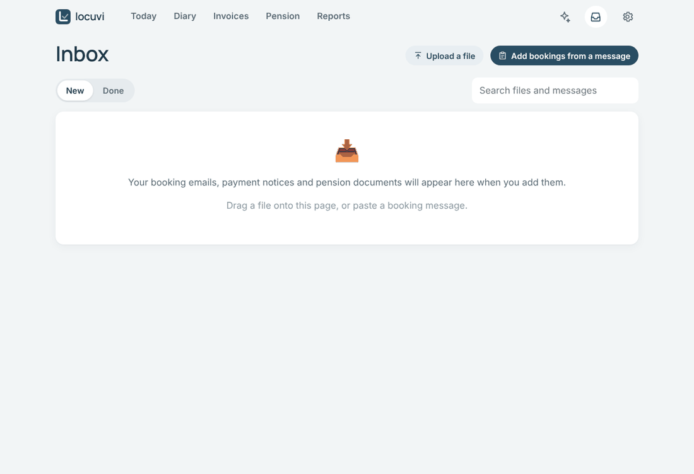

- **Add things**: tap **Upload a file**, drag a file onto the page, or paste a message. PDFs,
  photos, text files, CSV files and saved emails (`.eml`) all work.
- **Tell Locuvi what it is**: Booking, Payment advice, Bank statement, Pension form or Other.
- **Bookings**: tap **Find booked sessions** to turn a booking email into diary sessions
  (you check them first).
- **Payment advice** mentioning an invoice number appears on that invoice's page.
- When you've dealt with something, tap **I've dealt with this**. It moves to **Done**.

### Letting Locuvi read your email (optional)

Locuvi can check chosen email folders, such as a "Locum" folder, every hour. Booking emails
and payment notices appear in your Inbox for you to check. It **only reads**: it never
sends, moves, deletes or marks anything as read. Gmail, Outlook, Microsoft 365, iCloud,
Fastmail and most others work, and you can add several accounts.

👉 [Connecting your email](EMAIL_SETUP.md), step by step.

## 13. The AI assistant (optional)

Locuvi reads most simple booking emails by itself. If you'd like help with messy emails,
scanned letters and photos, you can turn on an AI assistant from the company of your choice:
OpenAI (GPT), Anthropic (Claude), Google (Gemini), xAI (Grok), Mistral, Cohere (Command),
DeepSeek, Alibaba (Qwen), Moonshot AI (Kimi), Z.ai (GLM), MiniMax or OpenRouter, or **your own
server** (for example Ollama), so booking text never leaves your network. It's **off** until
you turn it on.

With it on, the ✨ icon opens **Ask Locuvi**:

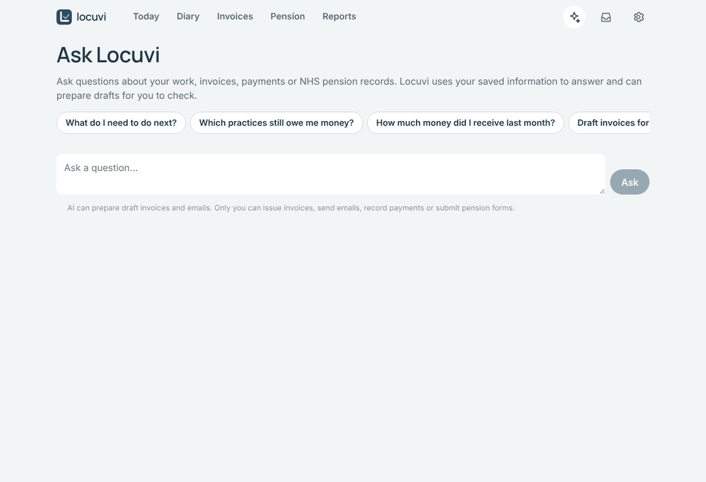

Ask things like:

- *What do I need to do next?*
- *Which practices still owe me money?*
- *How much money did I receive last month?*
- *Draft invoices for last month*
- *Am I up to date with my NHS pension paperwork?*

It answers from your own records and shows which ones it checked. It can prepare **draft**
invoices and emails for you to check. It **can't** issue invoices, send emails, record
payments or submit pension forms.

👉 [Setting up the AI assistant](AI_SETUP.md): choosing a company, getting a key, what's sent
and costs.

## 14. Settings, one by one

Tap the gear icon at the top right.

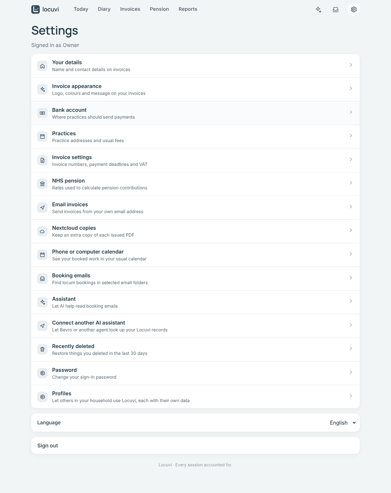

<details open>
<summary><b>Your details</b>: what's printed at the top of your invoices</summary>

Your full legal name, a business name if you use one, your job title on invoices (for
example *General Practitioner (Locum)*), address, email and telephone. Changes only affect
**new** invoices.
</details>

<details>
<summary><b>Invoice appearance</b>: logo, colour and wording</summary>


- **Logo**: SVG (sharpest when printed), PNG, JPEG or WebP. Locuvi tidies and resizes it.
- **Colour used on invoices**: Steel, Navy, Teal, Forest, Plum, Burgundy or Charcoal.
- **Message at the bottom of each invoice**, for example *Thank you for your business.*
- **How to end your emails**: your sign-off on emails Locuvi prepares.
- **Preview a sample invoice** to see the result.

Issued invoices keep the look they had when they were issued.
</details>

<details>
<summary><b>Bank account</b>: where practices pay you</summary>

Name on the account, sort code and account number. New details appear on future invoices
only. The account number is shown masked (••••1234).
</details>

<details>
<summary><b>Practices</b>: addresses, fees and how each practice likes invoices</summary>

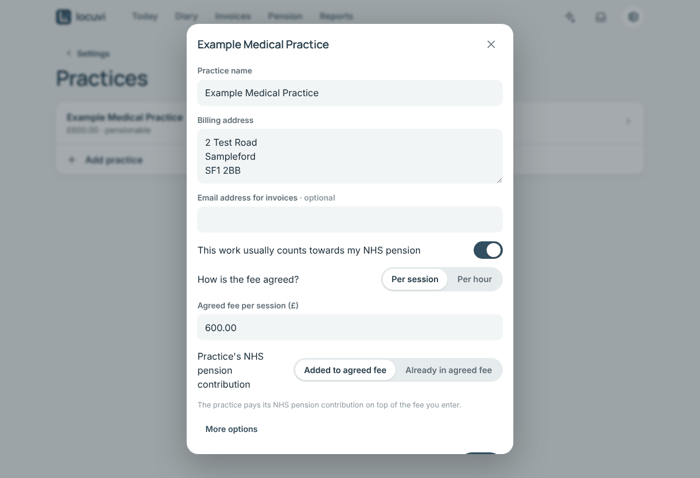

For each practice: name, billing address, email for invoices, whether the work usually counts
towards your NHS pension, how the fee is agreed (**Per session** or **Per hour**), the agreed
fee, and whether the pension contribution is **added to** or **already in** that fee.

Under **More options**: who to contact, days allowed to pay (if different from your usual),
the **practice code** (ODS code, needed on some pension forms), **Practice requires a PO
number**, **How this practice wants invoices** (your own notes, shown when you invoice them),
and the **person who signs Form A**. You can also hide a practice you no longer work for.
</details>

<details>
<summary><b>Invoice settings</b>: numbers, payment deadlines and VAT</summary>

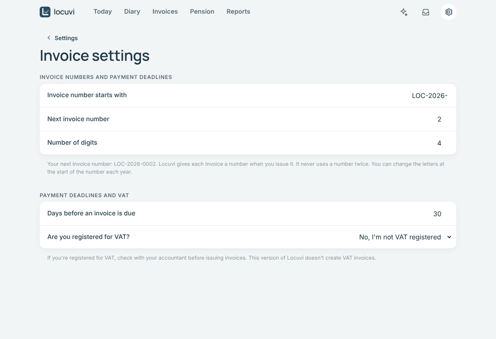

- **Invoice number starts with** (for example `LOC-2026-`), **Next invoice number** and
  **Number of digits**. Locuvi shows your next number. In a new year it offers to switch the
  start, for example to `LOC-2027-`.
- **Days before an invoice is due**: your usual payment deadline (for example 30).
- **Are you registered for VAT?** Locuvi doesn't create VAT invoices. If you choose "Yes",
  issuing is switched off; talk to your accountant.
</details>

<details>
<summary><b>NHS pension</b>: rates and your details for the forms</summary>

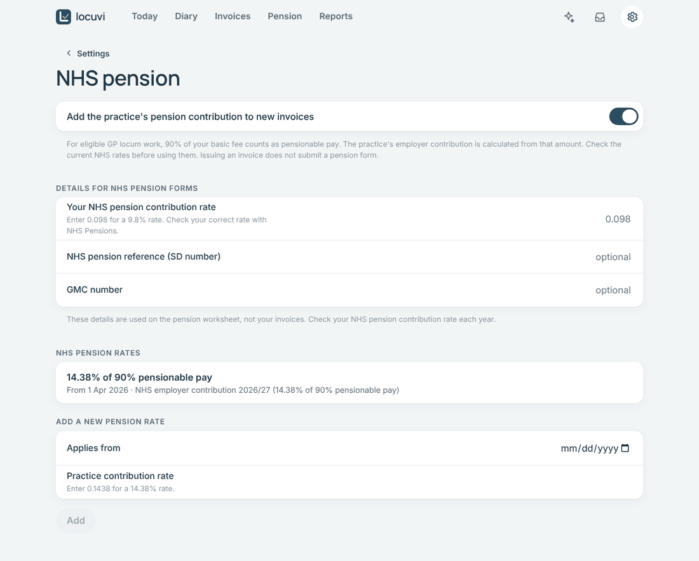

- **Add the practice's pension contribution to new invoices**: on for most GP locum work.
- **Your NHS pension contribution rate**: for example `0.098` for 9.8%. Check yours with
  NHS Pensions each year.
- **NHS pension reference (SD number)** and **GMC number**: used on the pension worksheet,
  not your invoices.
- **NHS pension rates**: the practice contribution rate and the date it applies from. Locuvi
  comes with 14.38% from 1 April 2026. When the rate changes, add the new one with its start
  date; older invoices keep their rate.
</details>

<details>
<summary><b>Email invoices</b>: send from your own address, and a weekly summary</summary>


Your email address, the name practices will see, your provider's outgoing (SMTP) server,
username and password. **Send me a copy** sends you a copy of each invoice email. Tap
**Send test email** to check it works. Step-by-step instructions for Gmail, iCloud and others
are in [Connecting your email](EMAIL_SETUP.md#part-2-sending-invoices-from-your-email-address).

Once email is on, **Email me a weekly summary** sends a short to-do list on Monday mornings,
only when there's something to do.
</details>

<details>
<summary><b>Nextcloud copies</b>: an extra copy of every PDF</summary>

If you use Nextcloud (a private cloud storage service), Locuvi can save a copy of every
issued invoice and credit note there, checking each copy matches the original. Files are
named by invoice number, not practice name. Ask whoever set up Locuvi to help; see
[Setting up Locuvi](SETUP.md#nextcloud-copies-optional).
</details>

<details>
<summary><b>Phone or computer calendar</b>: see your bookings in your usual calendar</summary>

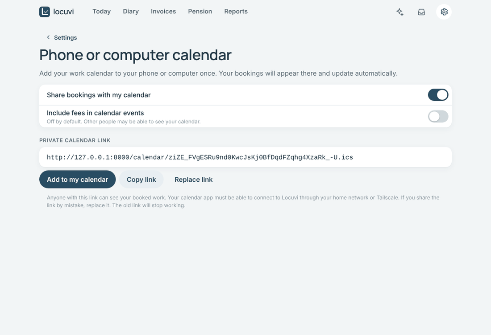

Turn on **Share bookings with my calendar** and tap **Add to my calendar**. Your bookings
then appear in your calendar app (iPhone, Android, Outlook, Google Calendar) and update by
themselves. Fees are left out unless you turn on **Include fees in calendar events**.

Anyone with the link can see your bookings. If you share it by mistake, tap
**Replace link**; the old one stops working. Your phone needs to be able to reach Locuvi (on
your home network, or through Tailscale; see [Setting up Locuvi](SETUP.md)).
</details>

<details>
<summary><b>Booking emails</b>: let Locuvi look for bookings in your email</summary>

See [Connecting your email](EMAIL_SETUP.md).
</details>

<details>
<summary><b>Assistant</b>: the optional AI assistant</summary>

See [Setting up the AI assistant](AI_SETUP.md).
</details>

<details>
<summary><b>Connect another AI assistant</b>: for Bevro and similar AI tools</summary>

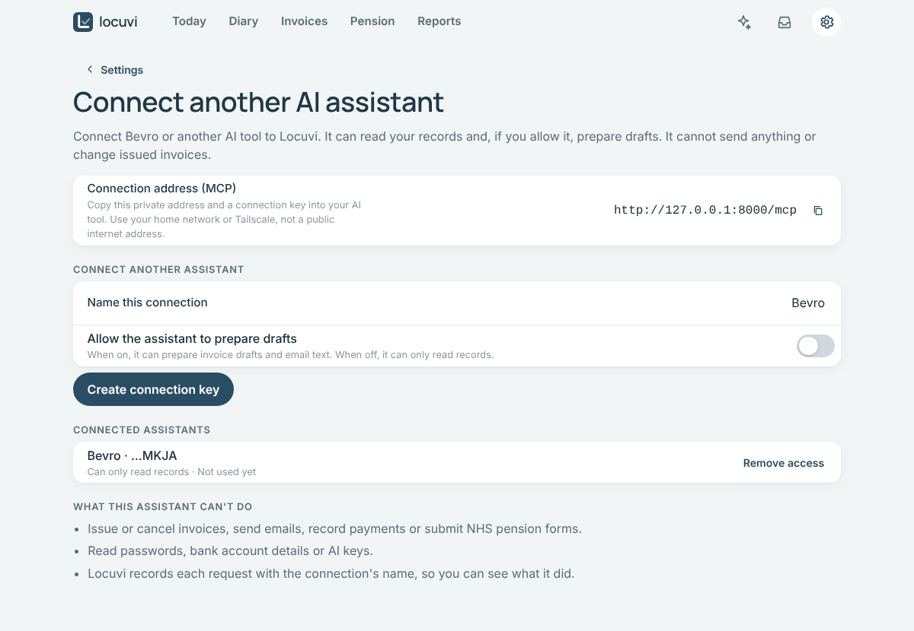

If you use an AI agent such as Bevro, it can look up your Locuvi records. Name the
connection, choose whether it may **prepare drafts** (otherwise it can only read), and tap
**Create connection key**. Copy the key straight away; Locuvi won't show it again. Tap
**Remove access** to stop it at any time. Connected assistants can never issue or cancel
invoices, send emails, record payments, submit pension forms, or see passwords, bank details
or AI keys. Every request is recorded.
</details>

<details>
<summary><b>Recently deleted</b>, <b>Password</b>, <b>Profiles</b> and <b>Language</b></summary>

- **Recently deleted**: see [section 15](#15-undo-deleting-and-recently-deleted).
- **Password**: change your password (at least 10 characters; a few unrelated words make a
  strong one). Your other devices are signed out.
- **Profiles**: see [section 16](#16-sharing-locuvi-with-your-household). Only the first
  user sees this.
- **Language**: English, Deutsch, Español, Français, Português or 한국어. English is
  complete; the other languages cover the main screens.
- **Sign out** is at the bottom.
</details>

## 15. Undo, deleting and Recently deleted

- **Undo**: most actions (adding a session, recording a payment, adding bookings) show a
  message at the bottom of the screen with an **Undo** button.
- **Deleting** always asks first, and says what will happen.
- **Recently deleted** (in Settings) keeps deleted things for **30 days**, then removes them
  for good. Tap **Restore** to bring one back.

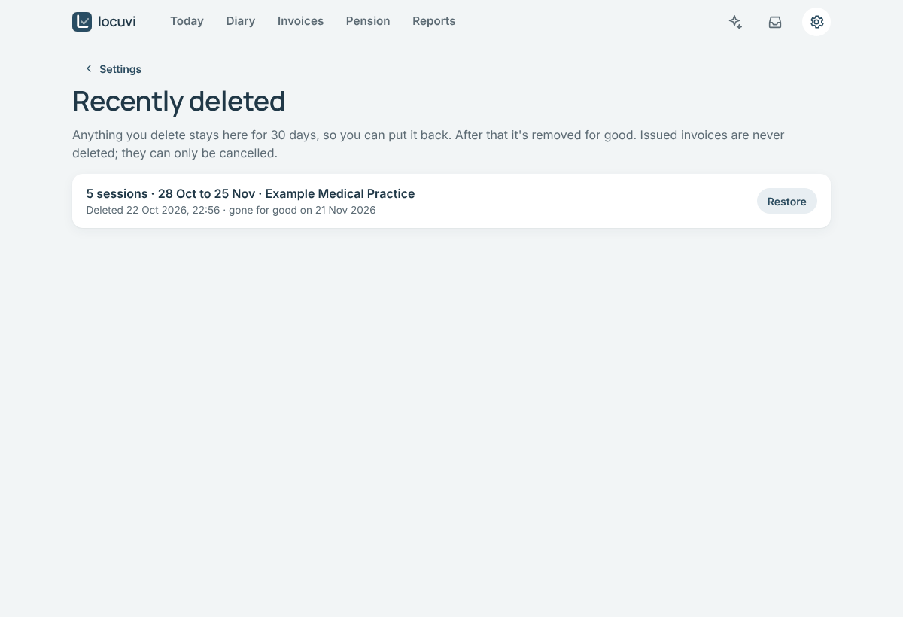

What goes to Recently deleted: sessions, draft invoices, payments and refunds, pension rates,
"Form B submitted" marks, inbox files and email accounts.

> [!NOTE]
> **Issued invoices are never deleted.** They can only be cancelled, so your numbering and
> records stay complete.

## 16. Sharing Locuvi with your household

The first person to use Locuvi **manages profiles**. In **Settings › Profiles** they can
**Add a profile** for someone else, for example a partner who's also a locum.

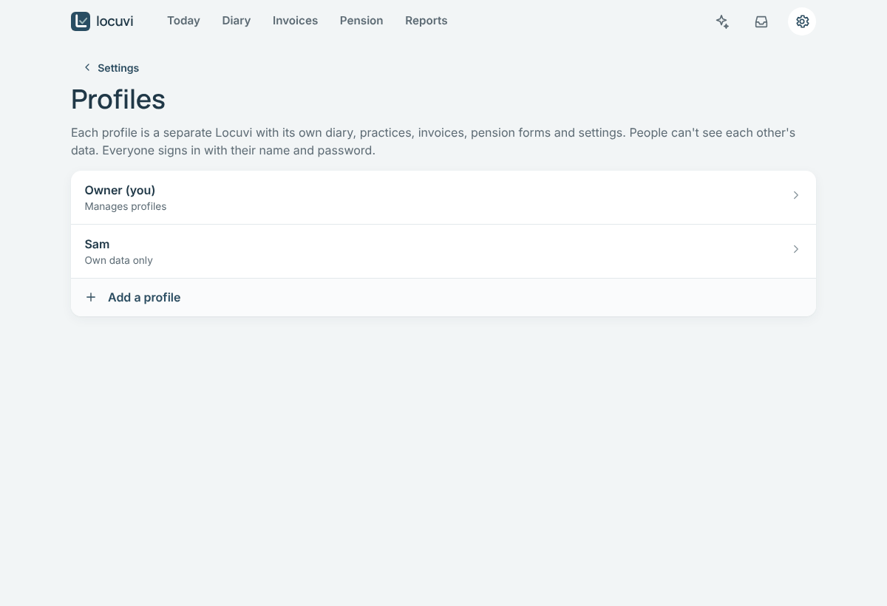

- Each person gets their **own name and password**, and a **completely separate** Locuvi:
  their own diary, practices, invoices and numbering, pension figures, email accounts and
  backups. Nobody can see anyone else's data.
- The person managing profiles must first set their own password (**Settings › Password**).
- They can set a new password for someone who's forgotten theirs. That signs the person out
  everywhere.
- **Remove profile** signs that person out at once. Their data is kept for 30 days and can
  be restored; after that it's deleted for good.

## 17. Using Locuvi on your phone

Everything works on a phone. The menu moves to the bottom of the screen.

<p>
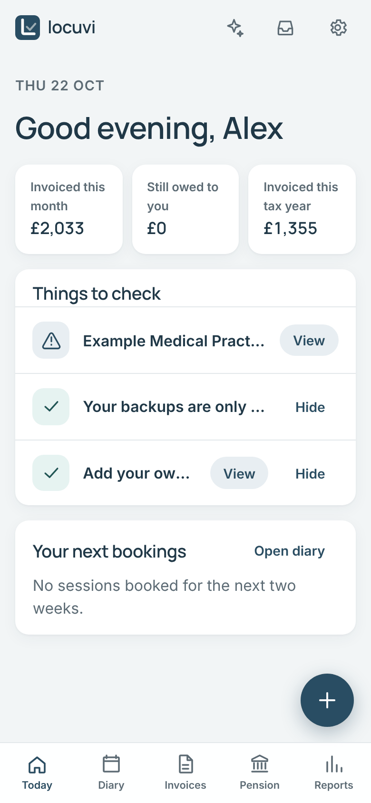
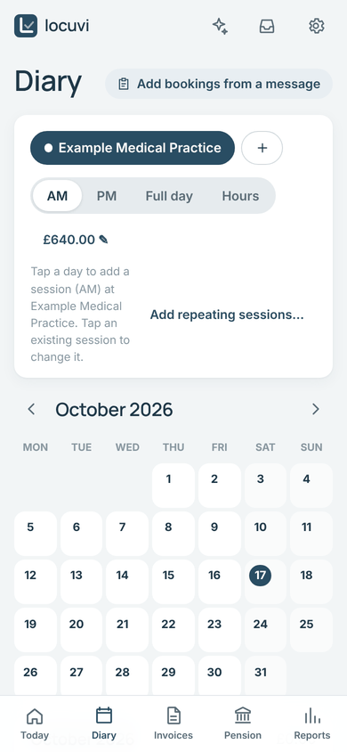
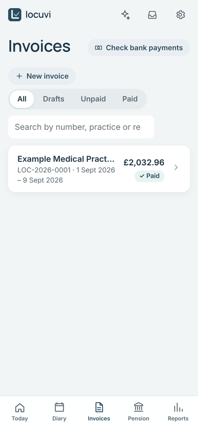
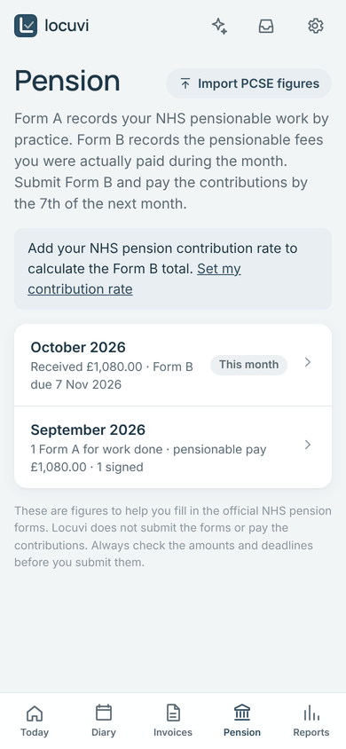
</p>

**Add it to your home screen** so it opens like an app:

- **iPhone or iPad (Safari)**: tap Share, then **Add to Home Screen**.
- **Android (Chrome)**: tap ⋮, then **Add to Home screen** or **Install app**.

## 18. Common questions

<details>
<summary><b>I made a mistake on an invoice I've already issued</b></summary>

Issued invoices can't be edited. Open it and tap **More**:
**Cancel invoice** if the practice hasn't recorded it yet, then **Make a new draft from
this**; or **Correct with a credit note** if they have. See
[Corrections](#9-corrections-cancelling-and-credit-notes).
</details>

<details>
<summary><b>I deleted something by mistake</b></summary>

Tap **Undo** in the message at the bottom of the screen, or go to
**Settings › Recently deleted** within 30 days.
</details>

<details>
<summary><b>I've forgotten my password</b></summary>

If someone else in your household manages profiles, ask them to set a new password in
**Settings › Profiles**. If you manage profiles, the person who looks after the server can
reset it ([how](SETUP.md#forgotten-password)).
</details>

<details>
<summary><b>The practice says my fee already included their pension contribution</b></summary>

Open **Settings › Practices**, choose the practice and set **Practice's NHS pension
contribution** to **Already in agreed fee**. New invoices will split the agreed fee into the
basic fee and the pension part. For an invoice already issued, use a credit note.
</details>

<details>
<summary><b>Does Locuvi submit my pension forms or send emails by itself?</b></summary>

No. Locuvi prepares figures and drafts. Sending an email, submitting a form or recording a
payment always needs your tap.
</details>

<details>
<summary><b>Is the pension rate right?</b></summary>

Locuvi comes with the 2026/27 employer rate (14.38% of 90% pensionable pay). Rates change.
Check them against current NHS Business Services Authority (NHSBSA) and PCSE guidance and
add new rates in **Settings › NHS pension**.
</details>

<details>
<summary><b>Can I use Locuvi if I'm VAT registered?</b></summary>

Not at the moment: Locuvi doesn't produce VAT invoices. Most GP medical services are exempt
from VAT, but ask your accountant if you're unsure.
</details>

<details>
<summary><b>Is my data safe? Who can see it?</b></summary>

Your data lives on your own computer or server, not with a company, and Locuvi doesn't track
you or send anything anywhere unless you set it up (for example email or AI). It backs itself
up every night. Read more in [Privacy and your data](PRIVACY.md).
</details>

<details>
<summary><b>Something isn't working</b></summary>

See [Troubleshooting](TROUBLESHOOTING.md) for common problems and fixes.
</details>

## 19. Words explained

| Word | Meaning |
| --- | --- |
| **Session** | A block of work: a morning (AM), afternoon (PM), full day, or a number of hours |
| **Draft** | An invoice you're still working on. You can change or delete it |
| **Issue** | Turn a draft into a final, numbered invoice with a PDF. It can't be changed afterwards |
| **Cancel (void)** | Mark an issued invoice as cancelled. It stays on record with its number |
| **Credit note** | An official document that reduces an invoice that's already been issued |
| **PO number** | Purchase order number: a reference some practices need on every invoice |
| **Pensionable pay** | The part of your NHS fees that counts towards your NHS pension: 90% of the fee |
| **Employer contribution** | What the practice pays into your NHS pension on top of your fee (currently 14.38% of pensionable pay) |
| **Form A** | The NHS locum form for work at one practice in one month. The practice signs it |
| **Form B** | The monthly NHS locum form for the money you received, sent with your contributions |
| **10-week deadline** | The NHS deadline for getting pension paperwork for a piece of work submitted |
| **SD number** | Your NHS pension scheme reference |
| **ODS code** | The NHS code that identifies a practice |
| **PCSE** | Primary Care Support England, which handles NHS pension administration for GPs |
| **Tax year** | 6 April to 5 April, the year HMRC uses |
| **CSV** | A simple spreadsheet file. Banks export them; Excel and Google Sheets open them |
| **Backup** | A complete copy of your records, so nothing is lost if the computer fails |
| **API key** | A password-like code from an AI company that lets Locuvi use their AI on your account |
| **Nextcloud** | Private cloud storage (like Dropbox) that you can run yourself |
| **Tailscale** | A free app that lets your own devices reach each other privately, from anywhere |
